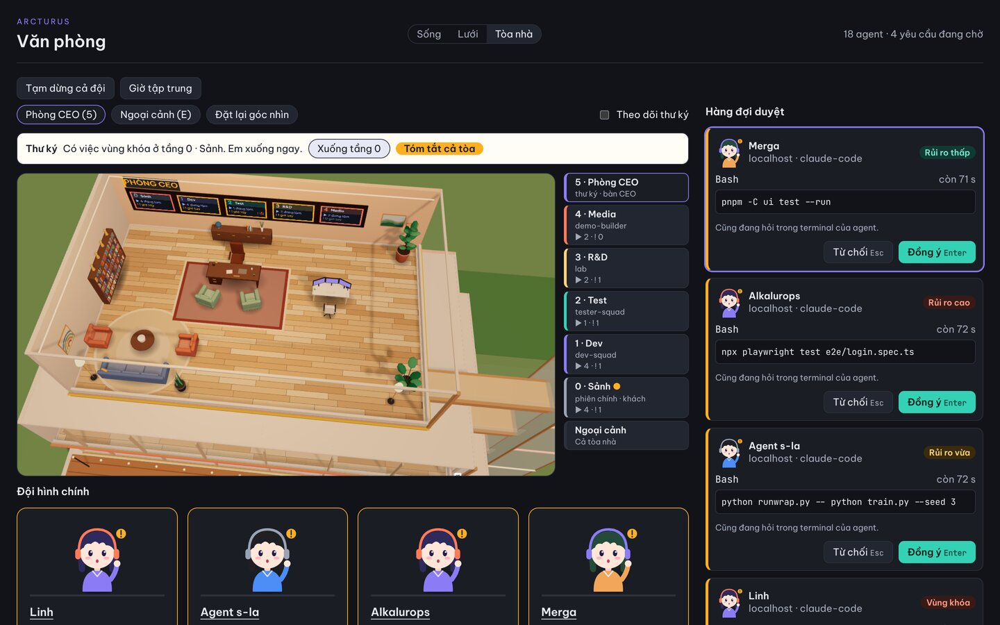
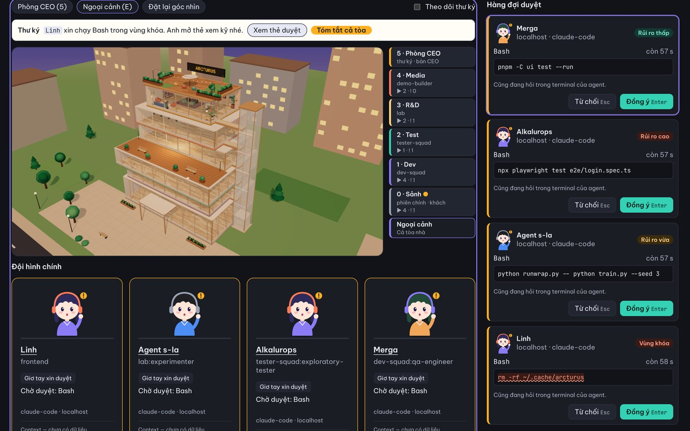
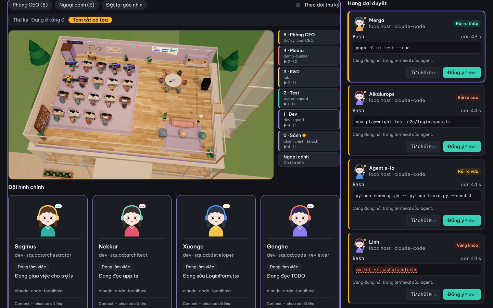
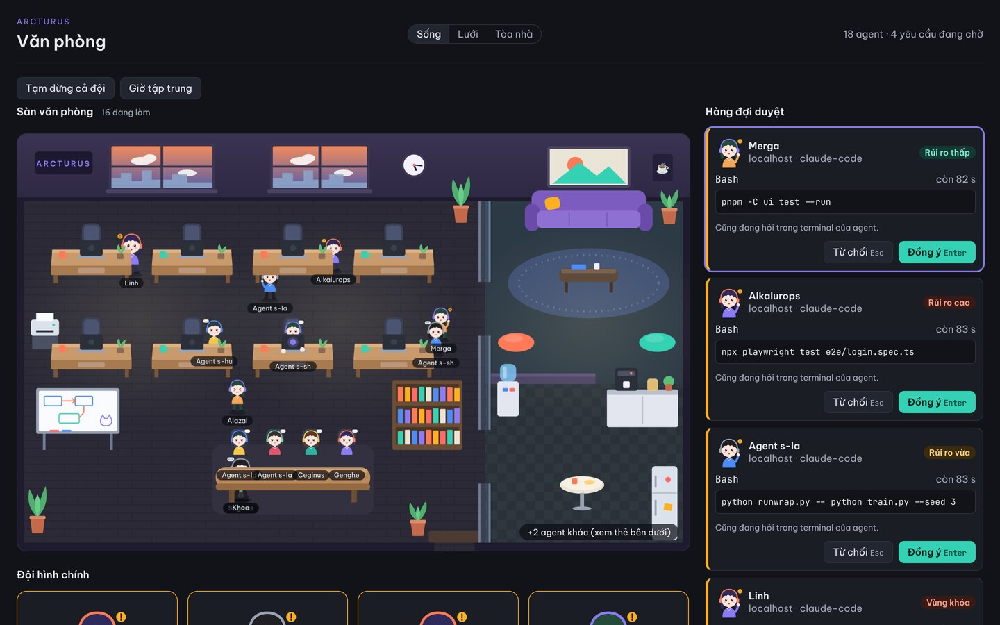
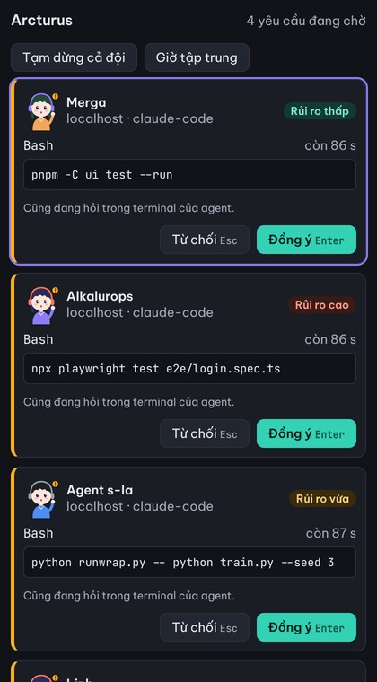
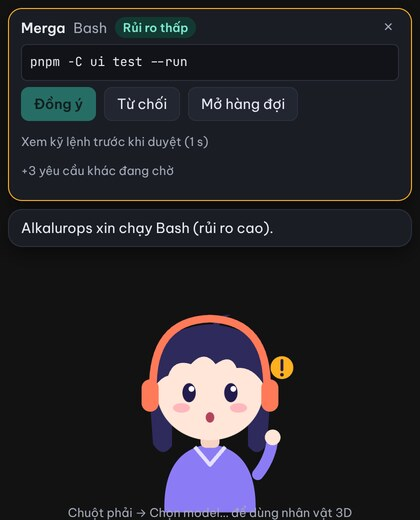

# Arcturus — buồng lái trưởng nhóm cho đội AI agent

Hub nhẹ chạy trên máy bạn, gom sự kiện từ nhiều phiên Claude Code để bạn thấy ai đang làm gì, ai đang giơ tay xin
duyệt, rồi duyệt/từ chối từ một chỗ, ủy quyền dần theo độ tin cậy. Mỗi agent là một nhân vật trong văn phòng: 2D, hoặc
một trụ sở 3D nhiều tầng có thư ký điều phối ở Phòng CEO. Trợ lý "Pet" là tùy chọn. Bối cảnh và quy tắc: `CLAUDE.md`;
kiến trúc: `docs/ARCHITECTURE.md`.



```
Claude Code ──HTTP hooks──► crates/hub (axum, 127.0.0.1:7878) ──WebSocket──► crates/app (Tauri) + ui/ (React)
                                  │
                           crates/hub-core: schema · state · policy · SQLite
```

## Trạng thái (cập nhật 2026-11-06, `main` tại `31c71a1` + art pass)

| Mốc | Trạng thái |
|---|---|
| **v0** (T0–T21, ARC-21…ARC-44) | Code xong. 19 task `done`; T13 (văn phòng 2D), T16 (đo ngân sách), T18 (dogfood), T20 (chỉ số) và T21 (cổng v0) đang `review`. Cổng v0 chạy ngày 2026-10-27 **chưa đạt**; các phát hiện bảo mật (vùng khóa, phát hiện 1–7) đã sửa kèm test hồi quy ở ARC-29 và ARC-42, test, e2e và ngân sách đã chạy lại và đạt (2026-10-28). **Còn chờ:** dogfood hằng ngày ≥ 2 tuần + baseline (T20), cài/gỡ trên máy sạch (T18), `cargo audit`. Báo cáo: `.squad/reports/2026-10-27-milestone-v0.md` |
| **v1 Pet** (P1–P12, ngoại lệ phạm vi, `docs/adr/0001-pet-v1.md`) | Đã merge, đang `review`. Pet 2D đạt ngân sách; bản 3D (VRM) chạy thật trên máy người dùng nhưng **chưa đo ngân sách**. Spike P0 chưa làm. Orchestrator tầng 2 (LLM) chỉ mới là ADR nghiên cứu (`docs/adr/0002-pet-orchestrator-tier2.md`), chưa có code |
| Sau v0 (chưa mã ARC) | Văn phòng sống (cảnh `live`, PR #33) và cài hook + tự kiểm tra ngay trong app (PR #34): đã merge, đề xuất ticket dưới ARC-34 và ARC-39 |
| **Cảnh Tòa nhà 3D** (chưa mã ARC, `docs/adr/0003-office-building.md`) | Đã merge (PR #36) + art pass 2026-11-06 (văn phòng ấm, nhân vật chi tiết). Opt-in, mặc định vẫn là `live`. **Chưa đo ngân sách** RAM/GPU trên WebView2 thật; định dạng `agent_type` `<plugin>:<agent>` còn là giả định, chờ `/hook-lab` |

Bảng task đầy đủ và nhật ký: `.squad/TASKS.md` (YouTrack project ARC).

### Số đo gần nhất (Windows 11, bản release, `scripts/measure.ps1`; lịch sử ở `docs/BUDGET.md`)

| Hạng mục | Đo được | Ngân sách |
|---|---|---|
| Hub idle | 13,4 MB WS, CPU 0,00% | ≤ 15 MB, ≈ 0% |
| Hub 20 phiên, 50 yêu cầu/s | đỉnh 16,8 MB WS, p99 ingest 1,26 ms | ≤ 40 MB |
| App chỉ tray | 16,8 MB WS | ≤ 60 MB |
| Popup mở | 74,7–77,6 MB private WS; mở 42 ms (rê chuột trước), 390 ms (đường nguội) | ≤ 150 MB; ≤ 300 / ≤ 500 ms |
| Pet 2D mở | 80,0 MB private WS; `pet_ready` 434 ms | ≤ 300 MB; ≤ 1 s |

## Đã có gì

**Hub** (`crates/hub`, `crates/hub-core`)
- Nhận hook ở `POST /hooks/event` và `POST /hooks/permission` (bắt buộc `Authorization: Bearer`, kiểm `Host`, chỉ bind loopback).
- Giữ `PermissionRequest` tới khi bạn trả lời; hết 110 s, lỗi, đầy hàng đợi, vượt trần byte hoặc tắt hub đều trả `{}`
  (không bao giờ `allow`) để Claude Code hỏi trong terminal. Tự hủy yêu cầu khi bạn đã trả lời ở terminal.
- Policy: chuẩn hóa lệnh (bỏ ký tự ẩn/bidi), danger list cho vùng khóa (`policy/danger.rs`), mức `risk`, batch rule,
  gom yêu cầu giống nhau, trust grant (đề xuất nâng mức sau chuỗi duyệt liên tiếp; Critical/High không bao giờ tự duyệt).
- State machine agent, persona theo worktree (`arcturus.toml`), SQLite WAL (events TTL 30 ngày, approvals, batch, trust),
  đối soát `claude agents --json` mỗi 30 s.
- WebSocket `/ws` (snapshot + delta, `docs/PROTOCOL.md`), `GET /approvals/{id}/input`, `GET /standup` (sinh từ sự kiện
  + `git log`, 0 token), `GET /healthz`.

**App desktop** (`crates/app`, Tauri 2) — chỉ là client của hub, tự khởi động hub làm tiến trình con
- Tray + badge số agent giơ tay. Menu: Mở hàng đợi duyệt · Mở văn phòng · Tạm dừng cả đội · Giờ tập trung · Hiện trợ lý ·
  Cài đặt và tự kiểm tra… · Thoát.
- **Popup Lite**: hàng đợi duyệt hiển thị `tool_input` gốc đã chuẩn hóa, Enter duyệt / Esc từ chối, "Duyệt cả N",
  đề xuất trust.
- **Văn phòng**: công tắc Sống / Lưới / Tòa nhà.
  - `live` (mặc định): agent rảnh đi dạo, tán gẫu; có việc thì về bàn; không rAF, dừng khi tab ẩn.
  - `grid`: lưới thẻ tĩnh.
  - `building` (3D, opt-in, `docs/OFFICE_BUILDING.md`): trụ sở 6 tầng. Tầng 0 Sảnh (phiên chính, khách); tầng 1–4 là
    các bộ plugin squad (`dev-squad`, `tester-squad`, `lab`, `demo-builder`), xếp theo tiền tố `agent_type` có danh sách
    trắng; tầng 5 Phòng CEO. **Thư ký** (Pet) ở Phòng CEO, đi thang máy tới tầng cần chú ý và dẫn bạn tới thẻ duyệt;
    không gửi lệnh nào lên hub, không duyệt thay bạn. three.js nạp muộn, chỉ vẽ khi có thay đổi, lỗi thì lui về `live`.
- **Cài đặt**: gộp/gỡ hook vào `~/.claude/settings.json` có xem trước diff (che token), sao lưu, token hook tự sinh;
  tự kiểm tra đầu-cuối settings → hub → WebSocket.
- **Pet** (opt-in): cửa sổ trong suốt, nhân vật 2D hoặc model `.vrm` bạn chọn (three-vrm nạp muộn), bong bóng duyệt
  (Critical không có nút Đồng ý), lệnh tầng 1 (tạm dừng, giờ tập trung, tóm tắt standup), giọng đọc của hệ điều hành
  (tùy chọn), kéo/thả, kích cỡ, mức nhắc.

**Công cụ**
- `tools/replay`: phát lại `fixtures/hooks/` (64 hook thật đã làm sạch) với số phiên/tốc độ tùy chọn, người duyệt giả,
  đo p50/p95/p99.
- `scripts/measure.ps1` / `measure.sh`: đo ngân sách hub, app, pet. `scripts/metrics.py`: chỉ số dogfood từ `arcturus.db`.
- `crates/hub/tests/e2e_claude.rs`: e2e với Claude Code thật (`claude -p`, `#[ignore]`): allow, deny, hết giờ, hub tắt, non-2xx.

## Ảnh chụp

Chụp ngày 2026-11-06 từ UI chạy trong Chromium, nối với **hub thật** (`target/debug/hub`). Hook gửi vào hub mô phỏng
4 phiên Claude Code và 15 subagent của 4 plugin, kèm 4 yêu cầu duyệt bị giữ. Dữ liệu là dữ liệu thử, không phải dogfood.
Cảnh 3D dựng bằng SwiftShader (không GPU), nên màu và độ mịn trên máy thật có thể khác.

| | |
|---|---|
|  |  |
| Ngoại cảnh: mỗi tầng một bộ plugin, thang máy kính, vườn mái | Tầng 1 Dev (`dev-squad`) cắt lớp; thẻ "Đội hình chính" bên dưới |
|  |   |
| Cảnh `live` (mặc định) với hàng đợi duyệt | Popup Lite và Pet 2D (bong bóng duyệt) |

Trong lần chạy này, luồng duyệt đi đủ đầu-cuối qua hub thật:
- bấm Đồng ý trên popup → hook nhận `allow`;
- bấm Từ chối → `deny`;
- không trả lời (kể cả lệnh vùng khóa `rm -rf ~/...`) → `{}` sau 110 s, không bao giờ `allow`.

## Bắt đầu nhanh

Cần: Rust stable (`rust-toolchain.toml`), Node 24 + pnpm, Claude Code đã chạy ít nhất một lần. Trên Linux, app cần
`libwebkit2gtk-4.1` và GTK.

```bash
git clone <url-repo-arcturus> arcturus && cd arcturus
cargo build -p hub
pnpm -C ui install
pnpm -C crates/app install
pnpm -C crates/app tauri dev
```

App chỉ hiện icon ở khay hệ thống và tự chạy hub ở `127.0.0.1:7878`. Lần đầu, cửa sổ **Cài đặt** tự mở: xem trước diff,
bấm **Đồng ý cài**, mở một phiên `claude` mới rồi bấm **Chạy tự kiểm tra**. Gỡ bằng nút **Gỡ hook…**.

Persona (tên, vai trò, màu nhân vật theo thư mục):

```bash
mkdir -p ~/.config/arcturus && cp arcturus.example.toml ~/.config/arcturus/arcturus.toml   # Windows: %APPDATA%\arcturus\
```

Cài bằng script (`scripts/dogfood-install.sh`, cần `jq` và `ARCTURUS_TOKEN`), đổi cổng, đo chỉ số và xử lý sự cố:
`docs/DOGFOOD.md`. **An toàn khi thử:** hub chết, tắt, hết giờ hay sai token đều là lỗi không chặn; terminal luôn hỏi
song song với popup.

### Chạy UI trong trình duyệt (không cần app)

Dùng khi muốn xem giao diện hoặc chụp ảnh mà không build Tauri:

```bash
cargo build -p hub
ARCTURUS_TOKEN=<token hook ≥32 ký tự> target/debug/hub --ui-token-file /tmp/arcturus-ui-token
VITE_HUB_WS_URL=ws://127.0.0.1:7878/ws VITE_HUB_TOKEN=$(cat /tmp/arcturus-ui-token) pnpm -C ui dev
```

Rồi mở `http://127.0.0.1:5173/` (popup), `/?view=office`, `/?view=pet`. Có thể gửi sự kiện bằng
`cargo run -p replay -- fixtures/hooks` hoặc bằng hook thật của Claude Code (`docs/DOGFOOD.md`). Cửa sổ Cài đặt
(`?view=setup`) chỉ chạy trong app.

## Lệnh phát triển

```bash
cargo build --workspace
cargo test --workspace
cargo clippy --workspace --all-targets -- -D warnings
cargo fmt --all
cargo run -p hub                      # chạy hub riêng ở 127.0.0.1:7878
cargo run -p replay -- fixtures/hooks # phát lại sự kiện
pnpm -C ui install && pnpm -C ui dev  # UI dev server (?view=office, ?view=pet…)
pnpm -C ui test
cargo clippy --manifest-path crates/app/src-tauri/Cargo.toml --all-targets -- -D warnings
```

`crates/app` có workspace Cargo riêng và không build trên CI (thiếu webkit trên runner). CI (`.github/workflows/ci.yml`)
chạy fmt/clippy/test Rust, test + build + `pnpm audit` cho UI, shellcheck và test của các script.

## Cấu trúc repo

| Đường dẫn | Nội dung |
|---|---|
| `crates/hub-core/` | Thư viện thuần: `schema.rs` (Event v1), `state.rs`, `policy/`, `store.rs`, `protocol.rs`, `standup.rs` |
| `crates/hub/` | Daemon axum: hook, giữ yêu cầu duyệt, WebSocket, đối soát, standup |
| `crates/app/` | Tauri 2: tray, popup, văn phòng, pet, cài đặt, chế độ đo |
| `ui/` | React + Vite + TypeScript strict: `views/` (LitePopup, Office, Pet, Setup), `components/`, `live/`, `pet/` |
| `tools/replay/` | Phát lại fixture vào hub |
| `fixtures/hooks/` | JSON hook thật đã ghi (đã xóa thông tin nhạy cảm) |
| `hooks/arcturus-dogfood.json` | Hook để Claude Code đẩy sự kiện vào hub |
| `scripts/` | Cài/gỡ hook, đo ngân sách, chỉ số dogfood, `start-lanes.sh` (4 phiên song song trong tmux) |
| `lab/` | Cấu hình hub "ghi băng" ở cổng 7879 cho thí nghiệm hook |

## Tài liệu

| File | Dành cho | Vai trò |
|---|---|---|
| `CLAUDE.md` | Claude | Bối cảnh, 7 quy tắc bất biến, làn và vùng sở hữu, định nghĩa "xong" |
| `docs/WORKFLOW.md` | Bạn | Quy trình 3 giai đoạn, nhịp một ngày, câu lệnh mẫu |
| `docs/PLAN.md` | Claude | Hợp đồng chung (§1–5), thiết kế và test bắt buộc từng task T0–T21, Pet v1 (§7) |
| `docs/ARCHITECTURE.md` | Cả hai | Thành phần, luồng duyệt, schema sự kiện, bảng SQLite |
| `docs/PROTOCOL.md` | Cả hai | Thông điệp WebSocket hub ↔ UI và route HTTP |
| `docs/HOOK_FINDINGS.md` | Cả hai | Hành vi thật của hook Claude Code đã kiểm chứng (ưu tiên hơn PLAN.md khi mâu thuẫn) |
| `docs/BUDGET.md` | Cả hai | Ngân sách RAM/CPU, kịch bản đo, lịch sử đo |
| `docs/DOGFOOD.md` | Bạn | Cài/gỡ hook, chạy app, đo chỉ số dùng thật |
| `docs/OFFICE.md`, `docs/OFFICE_LIVE.md`, `docs/OFFICE_BUILDING.md` | Cả hai | Văn phòng 2D, cảnh `live`, cảnh Tòa nhà 3D và thư ký |
| `docs/UI_EXTENSION.md` | Cả hai | Điểm thay thế giao diện mà không đụng logic duyệt |
| `docs/CHARACTER_STYLES.md`, `docs/mockups/character-styles.html` | Cả hai | Kiểu nhân vật 2D A (Chibi Plus, mặc định) và C (Pixel Sprite): thiết kế, mẫu chạy được, kế hoạch C1–C6 |
| `docs/adr/` | Cả hai | ADR 0001 Pet v1, ADR 0002 nghiên cứu orchestrator tầng 2, ADR 0003 Tòa nhà 3D, ADR 0004 kiểu nhân vật 2D |
| `.squad/TASKS.md`, `.squad/reports/` | Cả hai | Bảng task, nhật ký, báo cáo cổng mốc |
| `.claude/settings.json` | Claude Code | Quyền: cho phép build/test, hỏi khi push, chặn lệnh nguy hiểm và đọc bí mật |
| `.claude/agents/` | Claude | `hook-spike` (thực nghiệm hook), `budget-guard` (đo ngân sách) |
| `.claude/skills/` | Bạn gõ lệnh | `/next-task hub`, `/hook-lab Q1`, `/budget-check`, `/milestone-gate v0` |

Agent dùng chung như `code-reviewer`, `security-auditor`, `qa-engineer` lấy từ plugin dev-squad đã cài, không định nghĩa lại.

## Giấy phép

MIT (`LICENSE`).
