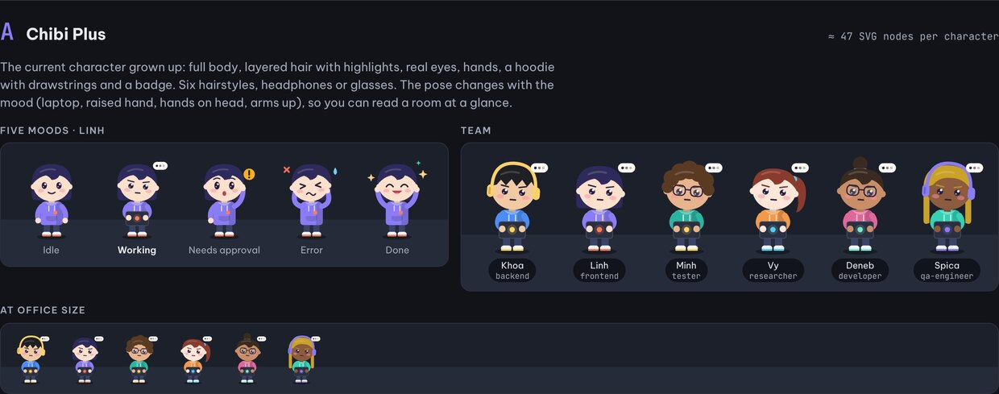
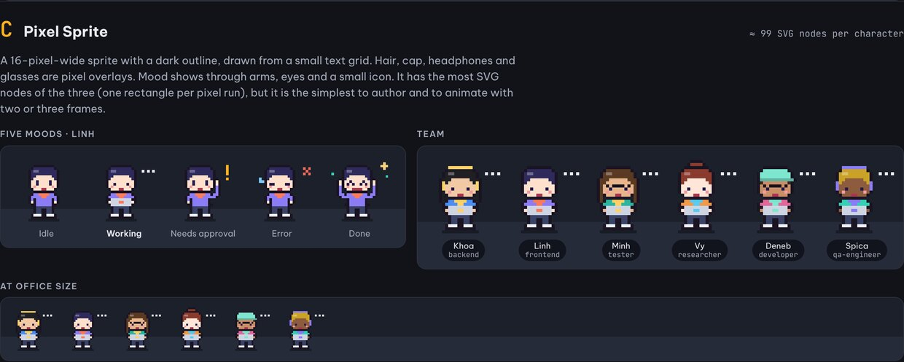

# Kiểu nhân vật 2D: A "Chibi Plus" và C "Pixel Sprite"

Trạng thái: **đề xuất, người dùng đã chọn A và C ngày 2026-11-11**. Chưa có mã ARC (đề xuất ticket dưới story T11 · ARC-32).
Quyết định kiến trúc: `docs/adr/0004-character-styles.md`. Mẫu tham chiếu chạy được: `docs/mockups/character-styles.html`
(mở trực tiếp trong trình duyệt, không cần build).

## 0. Bối cảnh

Nhân vật 2D hiện tại (`ui/src/components/Character.tsx`, T11) là nửa thân: đầu tròn, tai nghe, áo cổ chữ V, mood thể hiện
qua mắt, miệng và dấu "!". Người dùng thấy **quá đơn giản**: các agent trông gần như giống nhau, khó phân biệt ai với ai
trong văn phòng, và tư thế không nói gì về việc đang làm.

Ngày 2026-11-10 có ba mẫu (A Chibi Plus, B Flat Editorial, C Pixel Sprite). Ngày 2026-11-11 người dùng **giữ A và C**,
bỏ B (mặt quá tối giản, các agent khó phân biệt).

| A · Chibi Plus | C · Pixel Sprite |
|---|---|
|  |  |

## 1. Phạm vi

- Chỉ làn `ui` (`ui/src/components/`, `ui/src/live/`, `ui/src/views/`). Không đổi hub, schema, giao thức, `crates/app/`.
- Hai kiểu vẽ mới đi qua điểm thay thế có sẵn `AVATAR_RENDERERS` (`ui/src/components/AgentAvatar.tsx`,
  `docs/UI_EXTENSION.md`). Nơi dùng (thẻ duyệt, bàn, đội, popup, pet 2D, văn phòng sống) chỉ đổi cách gọi một lần.
- **A là mặc định**, thay kiểu `svg` hiện tại. **C là tùy chọn** người dùng bật. Kiểu cũ giữ tên `classic` trong một bản
  phát hành để so sánh và lui về nếu A có vấn đề, rồi gỡ (câu hỏi mở §9).
- Không làm: cảnh 3D (`building`) có nhân vật riêng (`ui/src/building/figure.ts`), không đổi ở đây; VRM; Lottie.

## 2. Hợp đồng bộ vẽ

`AvatarRendererProps` hiện có `mood`, `palette`, `size`, `label`. Thêm hai trường **tùy chọn**, tương thích ngược:

```ts
export type AvatarStyle = 'chibi' | 'pixel' | 'classic';
export const DEFAULT_AVATAR_STYLE: AvatarStyle = 'chibi';

export type AvatarPose = 'stand' | 'sit' | 'walk';

export interface AvatarRendererProps {
  mood: Mood;
  palette: Palette | undefined;
  size: number;          // chiều rộng (px)
  label: string;         // cho trình đọc màn hình
  /** Hạt giống chọn kiểu tóc, màu da, phụ kiện. Dùng `AgentView.id`. Thiếu thì lấy từ `label`. */
  seed?: string;
  /** Mặc định `stand`. Văn phòng sống dùng `sit` ở bàn và `walk` khi di chuyển. */
  pose?: AvatarPose;
}
```

- `seed` chỉ đi qua hàm băm (`lookOf(seed)`, §3), không bao giờ được vẽ ra. Tên agent vẫn chỉ hiện ở nhãn React bên ngoài
  SVG như hiện nay (dữ liệu không tin cậy, quy tắc bất biến 3).
- Màu chỉ lấy từ `palette` (đã kiểm `#RRGGBB` ở hub và lại ở `color()` của bộ vẽ) cộng các màu cố định của bộ vẽ.
- Bộ vẽ không gọi hub, không đọc store, không có timer. Chuyển động chỉ bằng CSS, theo `useMotionPolicy` và
  `prefers-reduced-motion`.

## 3. Chọn ngoại hình tất định: `lookOf(seed)`

Mô-đun thuần `ui/src/components/avatarLook.ts`, dùng chung cho A và C:

```ts
export interface AvatarLook {
  hair: 0 | 1 | 2 | 3 | 4 | 5;   // A: thẳng mái, dựng, đuôi ngựa, búi, dài, xoăn. C: dùng hair % 4
  skin: 0 | 1 | 2 | 3 | 4 | 5;   // 6 màu da cố định
  accessory: 'none' | 'glasses' | 'headphones';
}
export function lookOf(seed: string): AvatarLook;
```

- Băm FNV-1a 32 bit trên `charCodeAt` (an toàn với surrogate lẻ, chuỗi rỗng, chuỗi rất dài), mỗi thuộc tính một luồng
  trộn riêng để tóc và da không tương quan.
- Cùng `seed` luôn ra cùng ngoại hình, ở mọi cửa sổ và mọi kiểu vẽ.
- Bảng màu da: `#FFE6D8`, `#FFE0CC`, `#F2C9A5`, `#E8B48C`, `#C98E66`, `#8D5B3E`.

## 4. Kiểu A · Chibi Plus (mặc định)

Tham chiếu hình học: hàm `charA` trong `docs/mockups/character-styles.html`.

| Mục | Quy định |
|---|---|
| Khung | `viewBox="0 0 120 150"`, gốc ở chân (bóng elip tại y≈145) |
| Thân | đầu to (rx 33, ry 30), tai, má hồng, áo hoodie có dây rút và huy hiệu màu `acc`, quần, giày trắng viền `acc` |
| Tóc | 6 kiểu, có lớp sau (đuôi ngựa, búi, tóc dài) và lớp trước (mái), một vệt sáng |
| Phụ kiện | tai nghe hoặc kính, theo `lookOf` |
| Ngân sách | ≈ 47 nút SVG mỗi nhân vật (đo trong mẫu); tối đa 60 |

Mood thể hiện bằng **cả tư thế và gương mặt**, để nhìn ở cỡ văn phòng (≈ 60 px) vẫn đọc được:

| Mood | Tư thế | Mặt | Dấu hiệu |
|---|---|---|---|
| `idle` | tay buông | mắt tròn, cười nhẹ | không |
| `working` | ôm laptop, đầu nghiêng | mắt nheo tập trung, lông mày | bong bóng "…" |
| `approval` | một tay giơ cao | mắt mở to, miệng tròn | huy hiệu "!" màu `--approval` |
| `error` | hai tay ôm đầu | mắt "><", miệng méo | giọt mồ hôi, dấu ✕ đỏ |
| `done` | hai tay giơ lên | mắt cười, miệng mở | sao vàng, sao xanh |

`pose`: `stand` như bảng trên; `sit` bỏ chân, hạ thân để đặt sau bàn; `walk` hai khung chân luân phiên bằng CSS
`steps(2)`, chỉ gắn khi đang di chuyển (giống `live/Walker.tsx` hiện nay).

## 5. Kiểu C · Pixel Sprite (tùy chọn)

Tham chiếu: hàm `charC` và lưới `PX`, `PX_MOOD` trong `docs/mockups/character-styles.html`.

| Mục | Quy định |
|---|---|
| Khung | lưới 16 × 21 ô, `viewBox="-3 -3 24 26"`, `shape-rendering="crispEdges"`, CSS `image-rendering: pixelated` |
| Dữ liệu | lưới ký tự (`k` viền, `h` tóc, `s` da, `o` áo, `a` phụ kiện, …); mood chỉ thay vài hàng (`PX_MOOD`) |
| Lớp phủ | tóc dài, búi, mũ lưỡi trai (`hair % 4`), tai nghe, kính, tay giơ |
| Dấu hiệu | "!" vàng, ✕ đỏ, giọt mồ hôi, sao, ba chấm, vẽ bằng ô pixel |
| Ngân sách | ≈ 98–124 nút SVG (mỗi đoạn ô cùng màu trên một hàng là một `<rect>`) |

C nhiều nút SVG nhất trong các mẫu. Biện pháp:

1. Gộp ô cùng màu trên một hàng thành một `<rect>` (mẫu đã làm).
2. Ghi nhớ kết quả theo `(look, mood, pose, palette)`, vì lưới chỉ phụ thuộc các khóa này.
3. Nếu đo thấy văn phòng sống vượt ngân sách (16 nhân vật × ~120 nút ≈ 2.000 nút), vẽ mỗi sprite ra một
   `<canvas>` nhỏ hoặc `data:` URL một lần rồi dùng lại như ảnh. Chỉ làm khi số đo yêu cầu.

`pose="walk"`: hai khung chân (đổi hàng 17–20), luân phiên bằng CSS `steps(2)`.

## 6. Nơi dùng

| Nơi | Hiện nay | Sau thay đổi |
|---|---|---|
| Thẻ duyệt (`ApprovalCard`), bàn và đội (`AgentDesk`) | `AgentAvatar` | `AgentAvatar` + `seed={agent.id}` |
| Popup Lite (`views/LitePopup.tsx`) | `AgentAvatar` | `AgentAvatar` + `seed` |
| Pet 2D (`views/Pet.tsx`), là trợ lý chứ không phải agent | `Character` trực tiếp | `AgentAvatar` với `seed` cố định `"pet"` |
| Văn phòng sống (`live/Walker.tsx`) | `Character` trực tiếp, tự vẽ chân | `AgentAvatar` với `pose` `sit`/`walk`/`stand`; bỏ chân tự vẽ |
| Lưới (`DeskGridScene`) | qua `AgentDesk` | không đổi |

Sau khi chuyển, **mọi nơi hiện nhân vật 2D đều đi qua `AgentAvatar`**: không còn nơi nào gọi `Character` trực tiếp
(thêm test kiểm bằng `grep` trên mã nguồn, giống `noThree.test.ts`).

## 7. Chọn kiểu

- Công tắc "Nhân vật: Chibi / Pixel" trong Văn phòng, cạnh công tắc cảnh. Lưu ở `localStorage`
  (`arcturus.avatar.style`, đọc ghi trong `try/catch`; giá trị lạ thì về `chibi`).
- Popup và Pet đọc cùng khóa khi mở, để cả app dùng một kiểu. Đổi kiểu trong Văn phòng không cần đồng bộ trực tiếp sang
  cửa sổ đang mở; lần mở sau sẽ theo.
- Không thêm tùy chọn vào hub hay `arcturus.toml`.

## 8. Test bắt buộc

- `avatarLook.test.ts`: tất định; mọi giá trị hợp lệ với `''`, `'\ud800'`, chuỗi 10.000 ký tự, `__proto__`; 12 seed liền
  nhau cho ít nhất 4 kiểu tóc khác nhau.
- `ChibiAvatar.test.tsx`, `PixelAvatar.test.tsx`: mỗi mood vẽ đúng dấu hiệu (có "!" khi `approval`, không có khi `idle`);
  `aria-label` bằng `label`; màu ngoài `#RRGGBB` bị thay bằng màu mặc định; số nút SVG ≤ ngân sách (§4, §5);
  `pose="walk"` chỉ gắn lớp chuyển động khi được phép chuyển động.
- `AgentAvatar.test.tsx`: khóa lạ trong `localStorage` về `chibi`; `classic` vẫn vẽ được.
- Test nguồn: không file nào ngoài `components/` import `Character` trực tiếp.
- `styles.test.ts` vẫn xanh (màu và thời lượng trong CSS đi qua token).
- Không test nào cũ bị xóa.

## 9. Câu hỏi mở

1. Giữ `classic` bao lâu? Đề xuất: một bản phát hành, rồi gỡ nếu không ai chọn lại.
2. Kiểu C có nên dùng phông pixel cho nhãn tên trong văn phòng không? Đề xuất: không, giữ Be Vietnam Pro để đọc tiếng Việt
   có dấu.
3. Mã ARC cho việc này (đề xuất ticket dưới ARC-32).

## 10. Kế hoạch triển khai và đề xuất ticket

| # | Việc | Phụ thuộc | Ước lượng (buổi tối) |
|---|---|---|---|
| C1 | `avatarLook.ts` + test; mở rộng `AvatarRendererProps` (`seed`, `pose`), đổi `svg` thành `classic` | — | 1 |
| C2 | `ChibiAvatar` (kiểu A) + test, đặt làm mặc định | C1 | 2 |
| C3 | `PixelAvatar` (kiểu C) + test | C1 | 2 |
| C4 | Chuyển Popup, Pet 2D, `Walker` sang `AgentAvatar` (`pose`), test nguồn "không gọi `Character` trực tiếp" | C2 | 2 |
| C5 | Công tắc kiểu nhân vật trong Văn phòng, đọc chung ở Popup/Pet | C2, C3 | 1 |
| C6 | Đo ngân sách văn phòng sống với 16 nhân vật mỗi kiểu (`/budget-check`); bật canvas cho C nếu cần | C4 | 1 |

Cập nhật `docs/UI_EXTENSION.md` (bảng điểm thay thế) và `docs/OFFICE_LIVE.md` (Walker) cùng commit với C1 và C4.
